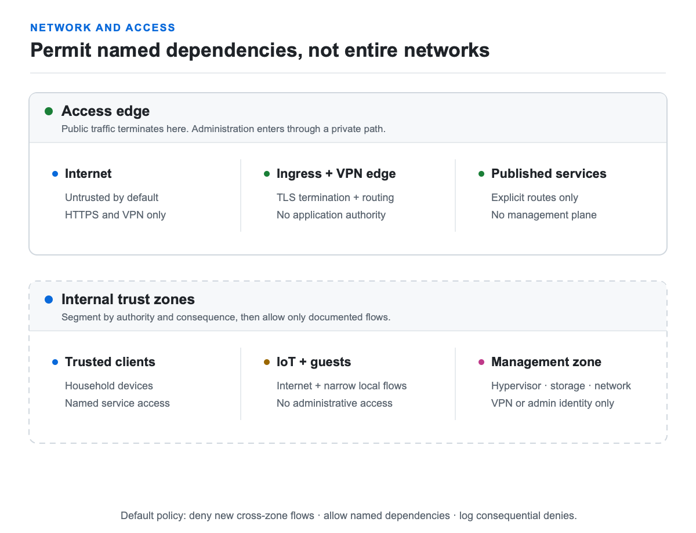

# Design networking and access

Segmentation should express trust and failure boundaries, not produce an
impressive VLAN count.

<picture>
  <source media="(prefers-color-scheme: dark)" srcset="images/trust-boundaries-dark.png">
  
</picture>

## Start with semantic zones

- **Trusted clients:** ordinary household computers and phones.
- **Services:** application hosts that accept defined client traffic.
- **Management:** hypervisors, switches, storage administration, and monitoring.
- **IoT and media:** devices that need limited local access and often broad
  internet access.
- **Guest/untrusted:** internet access without private-network reachability.
- **DMZ:** optional, for deliberately public services isolated from management.

Default-deny new flows between zones, then permit documented dependencies and
stateful return traffic. Keep management planes reachable only from the
management zone or a private VPN.

## DNS and DHCP

Pi-hole is the approachable default for network-wide blocking. Technitium is the
stronger default when you need authoritative internal zones, recursion, APIs,
policies, or clustering. AdGuard Home is a good turnkey alternative.

Run two resolvers on independent failure domains. Avoid a dependency loop where
each resolver, container runtime, identity service, and dashboard requires the
other resolver to start.

## Ingress

Caddy is the default for a small home because its configuration is compact and
automatic HTTPS is built in. Traefik earns its extra moving parts in dynamic
Docker or Kubernetes environments. Nginx Proxy Manager remains a reasonable
UI-first entry point when its database and configuration are backed up.

Keep administrative services private even when a reverse proxy can publish
them. A valid certificate does not make an admin panel safe for the internet.

## Remote access

Tailscale is the default because it makes a WireGuard-based private network
approachable and adds policy controls. Test grants and preserve recovery access.
Plain WireGuard is excellent for a small static peer set. Headscale is for
people who explicitly want to operate the coordination plane too.

Do not forward raw SSH, RDP, hypervisor, NAS, or router administration ports.

## Discovery protocols

Some household devices rely on multicast DNS or broadcast discovery. Relay it
narrowly between the exact zones that need it. Do not flatten segmentation just
to make discovery work.

## Primary references

- [NIST SP 800-207: Zero Trust Architecture](https://csrc.nist.gov/pubs/sp/800/207/final)
- [Pi-hole documentation](https://docs.pi-hole.net/)
- [Technitium DNS Server documentation](https://technitium.com/dns/)
- [Caddy automatic HTTPS](https://caddyserver.com/docs/automatic-https)
- [Tailscale access-control policies](https://tailscale.com/kb/1018/acls)

Next: [Protect storage and prove recovery](05-storage-backup.md).
