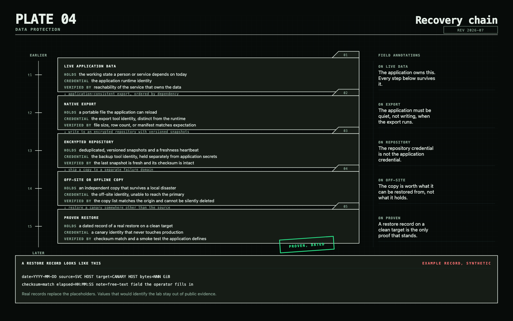

# Protect storage and prove recovery

Storage keeps bytes available. Backup makes independent, recoverable copies.
They are related systems, not synonyms.

## Storage defaults

TrueNAS Community Edition is the default dedicated NAS when you want a supported
OpenZFS appliance. The old FreeNAS name is obsolete, and TrueNAS CORE is a
maintenance path rather than the greenfield recommendation.

OpenZFS provides checksums, scrubs, snapshots, compression, and replication.
Unraid's classic parity array trades ZFS end-to-end integrity and self-healing
for flexible mixed-drive expansion. Its ZFS pools retain ZFS behavior, but do
not offer that same classic-array expansion model. OpenMediaVault is the lighter
Debian-based NAS. Synology is the polished commercial appliance choice.

TrueNAS now ships one major release a year, named for the year most systems
will run it; the release tested as 26 became 27. Plan a new major as storage
maintenance: wait for a point release, read the known issues, and do not run
`zpool upgrade` until every system that must import or receive the pool
supports the new features. Older software may not be able to open an upgraded
pool.

Once data matters, separate the storage failure domain from the experimentation
host. A starter all-in-one box is fine; a permanent single point of failure is a
decision, not an accident.

## Build a recovery chain

<picture>
  
</picture>

Target 3-2-1-1-0: three copies, two media or failure domains, one off-site, one
offline or immutable, and zero unverified errors.

1. Create an application-consistent database export or supported snapshot.
2. Capture an encrypted repository backup.
3. Copy it to an independent off-site or offline destination.
4. Monitor freshness and failures.
5. Restore a canary on a schedule.
6. Rehearse full disaster recovery periodically.

### Off-site and immutable copies

Encrypt client-side before any copy leaves the site.

- **Kopia** can use an S3 bucket created with Object Lock in compliance mode
  (`--retention-mode COMPLIANCE --retention-period 30d`). In compliance mode
  even the bucket's root user cannot delete locked objects early, so size the
  period carefully. Turn on `kopia maintenance set --extend-object-locks true`.
  Locks are renewed only by full maintenance, so full maintenance must run more
  often than the retention period.
- **Proxmox Backup Server** sync jobs can push to a remote PBS. A push job can
  encrypt snapshots that are unencrypted locally with an `active-encryption-key`,
  which suits a less trusted remote. PBS can also use an S3-compatible bucket as
  a datastore, but that datastore needs a local persistent cache (64 to 128 GiB
  recommended). Keeping nightly backups on a local datastore and syncing off
  site keeps the backup window independent of upload speed.
- **Self-hosted S3:** the upstream MinIO repository is archived. If you need
  S3-compatible storage for backups or an infrastructure-as-code state backend,
  choose a maintained server and enable bucket versioning.

### Database exports

A size check catches an empty dump. Only a restore into a disposable instance
of the same major version proves a dump is usable, so schedule one and check a
few row counts. For SQLite, `VACUUM INTO` writes a consistent snapshot of a
live database; copying the live file during a transaction, or without its
`-wal` file, can produce a corrupt copy. Your monitoring system's own database
needs the same treatment, because it holds every check and alert route.

Proxmox Backup Server is the default for Proxmox guests. Kopia is the default
general endpoint/file backup when policies and central management help. Restic
is the simpler CLI-first alternative. Borg remains excellent for Unix-to-Unix
repositories, but confirm the stable-version guidance before adopting a major
new generation.

## Avoid comforting mistakes

- RAID is availability, not backup.
- A ZFS snapshot is rollback, not an independent copy.
- Replication can faithfully copy deletion, corruption, or compromise.
- Syncthing and rclone move data; they are not backups by themselves.
- A green backup job is not a restore.
- A tiny canary restore proves the repository opens, not that your largest
  database restores.
- Encryption keys and recovery configuration belong in the recovery plan.

> **Field note:** The turning point in my own lab was treating restore proof as
> telemetry. Backup freshness, database-export ordering, and a recurring canary
> restore tell me more than a successful scheduler exit code.

## Primary references

- [TrueNAS Community Edition consolidation announcement](https://www.truenas.com/blog/truenas-community-edition-release-2504/)
- [OpenZFS documentation](https://openzfs.github.io/openzfs-docs/)
- [Proxmox Backup Server documentation](https://pbs.proxmox.com/docs/)
- [Kopia documentation](https://kopia.io/docs/)
- [Restic documentation](https://restic.readthedocs.io/)
- [Kopia ransomware protection and Object Lock](https://kopia.io/docs/advanced/ransomware-protection/)
- [Proxmox Backup Server: managing remotes and sync jobs](https://pbs.proxmox.com/docs/managing-remotes.html)
- [Proxmox Backup Server: S3 datastore backend](https://pbs.proxmox.com/docs/storage.html)
- [Archived MinIO repository](https://github.com/minio/minio)
- [TrueNAS 27 annual release announcement](https://www.truenas.com/blog/truenas-27-is-here/)
- [OpenZFS zpool-upgrade](https://openzfs.github.io/openzfs-docs/man/master/8/zpool-upgrade.8.html)
- [SQLite VACUUM INTO](https://www.sqlite.org/lang_vacuum.html)
- [SQLite: how to corrupt a database file](https://www.sqlite.org/howtocorrupt.html)
- [Syncthing](https://syncthing.net/)

Next: [Build security into the design](06-security.md).
