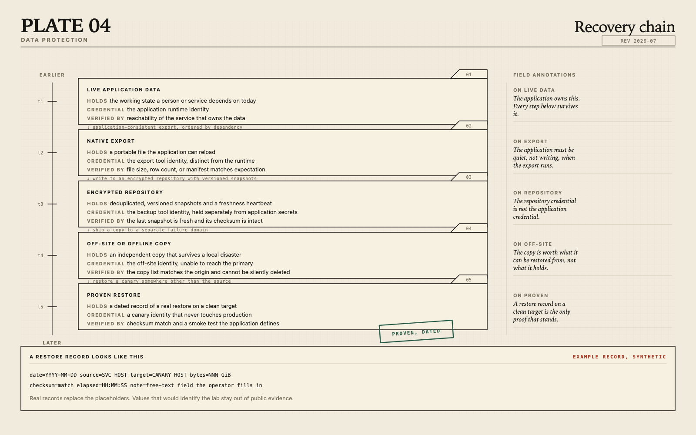

# Protect storage and prove recovery

Storage keeps bytes available. Backup makes independent, recoverable copies.
They are related systems, not synonyms.

## Storage defaults

TrueNAS Community Edition is the default dedicated NAS when you want a supported
OpenZFS appliance. The old FreeNAS name is obsolete, and TrueNAS CORE is a
maintenance path rather than the greenfield recommendation.

OpenZFS provides checksums, scrubs, snapshots, compression, and replication.
Unraid's classic parity array trades ZFS end-to-end integrity and self-healing
for flexible mixed-drive expansion. Its ZFS pools retain ZFS behavior, but do
not offer that same classic-array expansion model. OpenMediaVault is the lighter
Debian-based NAS. Synology is the polished commercial appliance choice.

Once data matters, separate the storage failure domain from the experimentation
host. A starter all-in-one box is fine; a permanent single point of failure is a
decision, not an accident.

## Build a recovery chain

<picture>
  <source media="(prefers-color-scheme: dark)" srcset="images/plate-04-dark.png">
  
</picture>

Target 3-2-1-1-0: three copies, two media or failure domains, one off-site, one
offline or immutable, and zero unverified errors.

1. Create an application-consistent database export or supported snapshot.
2. Capture an encrypted repository backup.
3. Copy it to an independent off-site or offline destination.
4. Monitor freshness and failures.
5. Restore a canary on a schedule.
6. Rehearse full disaster recovery periodically.

Proxmox Backup Server is the default for Proxmox guests. Kopia is the default
general endpoint/file backup when policies and central management help. Restic
is the simpler CLI-first alternative. Borg remains excellent for Unix-to-Unix
repositories, but confirm the stable-version guidance before adopting a major
new generation.

## Avoid comforting mistakes

- RAID is availability, not backup.
- A ZFS snapshot is rollback, not an independent copy.
- Replication can faithfully copy deletion, corruption, or compromise.
- Syncthing and rclone move data; they are not backups by themselves.
- A green backup job is not a restore.
- Encryption keys and recovery configuration belong in the recovery plan.

> **Field note:** The turning point in my own lab was treating restore proof as
> telemetry. Backup freshness, database-export ordering, and a recurring canary
> restore tell me more than a successful scheduler exit code.

## Primary references

- [TrueNAS Community Edition consolidation announcement](https://www.truenas.com/blog/truenas-community-edition-release-2504/)
- [OpenZFS documentation](https://openzfs.github.io/openzfs-docs/)
- [Proxmox Backup Server documentation](https://pbs.proxmox.com/docs/)
- [Kopia documentation](https://kopia.io/docs/)
- [Restic documentation](https://restic.readthedocs.io/)

Next: [Build security into the design](06-security.md).
