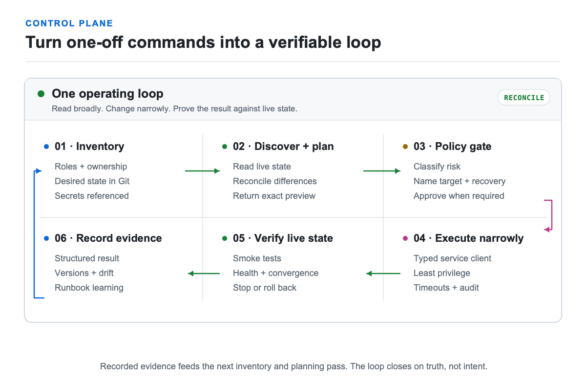

# Build a control plane

Automation becomes safe when inventory, desired state, execution, and evidence
have clear ownership.

<picture>
  <source media="(prefers-color-scheme: dark)" srcset="images/automation-loop-dark.png">
  
</picture>

## A practical progression

1. Put documentation and service configuration in Git.
2. Keep secrets outside Git and inject them at runtime.
3. Establish inventory and IPAM as the source of truth.
4. Use infrastructure as code for resources with stable provider support.
5. Use configuration management for operating-system and application state.
6. Wrap repeated service operations in a structured CLI.
7. Add drift checks and reconciliation reports.
8. Require preview, approval, and verification for mutations.

OpenTofu or Terraform can provision resources. Ansible can configure hosts.
Neither should become an undocumented shell-script bucket for every service API.
Keep service-specific operations close to typed clients and stable output.

## Machine-readable operations

A JSON-first CLI is valuable even before AI enters the picture:

- scripts can distinguish success from partial failure;
- dashboards can consume the same health data as operators;
- dry runs can return the exact proposed objects;
- stable error envelopes can name missing configuration; and
- evidence can be stored and compared over time.

Discovery coverage can be broad, but each query still needs least-privilege
authorization, bounded output, and redaction appropriate to its data. Mutations
should be narrow. Destructive actions need an explicit target, a preview that
matches execution, and proof of the final live state.

> **Field note:** My lab became easier to operate when I stopped treating SSH as
> the interface. Inventory resolution, structured service clients, dry runs, and
> smoke checks turned one-off commands into a control plane that both people and
> software could reason about.

## Primary references

- [Ansible documentation](https://docs.ansible.com/ansible/latest/index.html)
- [OpenTofu documentation](https://opentofu.org/docs/)
- [NetBox documentation](https://netboxlabs.com/docs/netbox/)
- [GitHub Actions documentation](https://docs.github.com/en/actions)

Next: [Add local AI and an agentic harness](10-ai-agentic.md).
