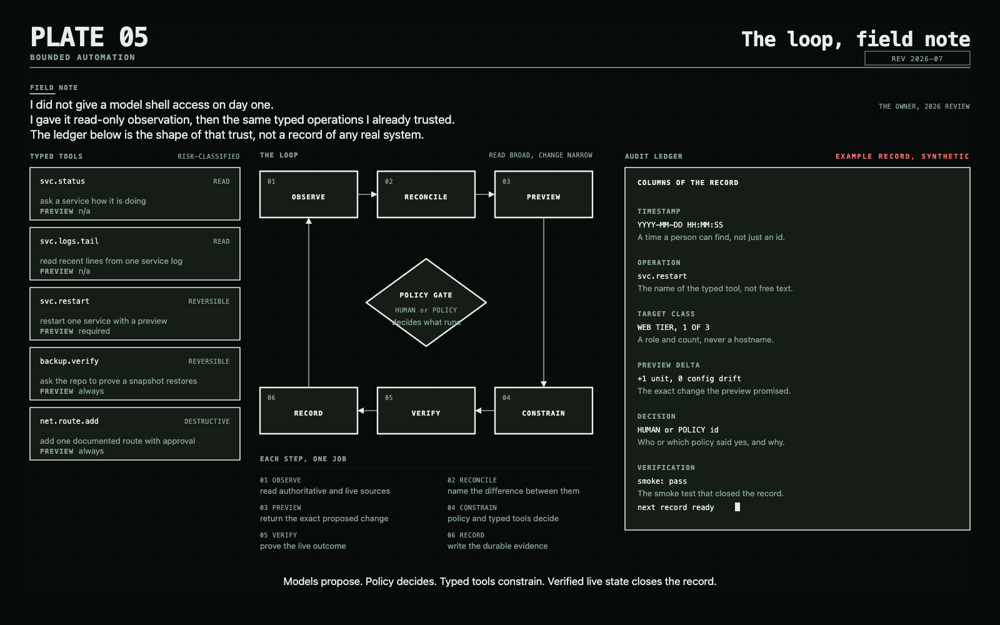

# Add local AI and an agentic operations harness

Local AI can keep sensitive work close to home, reduce latency, and make idle
hardware useful when the model, retrieval, telemetry, and tools are configured
without external egress. A bounded operations agent can also save real time on
routine investigation and change work. Neither is a reason to hand an
unbounded model a shell and hope.

## Local inference defaults

- **Ollama:** easiest default for one operator, broad hardware support, and local
  experimentation.
- **llama.cpp:** lower-level portability, tuning, and a minimal OpenAI-compatible
  server across varied hardware.
- **vLLM:** advanced multi-user throughput, batching, accelerator support, and
  API serving.
- **Open WebUI:** optional interface, not the inference layer. Treat imported
  functions as executable code with access to the host and data. Since v0.6.6
  it ships under its own license with a branding clause, which is not
  OSI-approved.

Ollama binds to `127.0.0.1:11434` by default, and its documentation describes no
built-in authentication. If other machines need it, put a TLS proxy with access
control in front instead of setting `OLLAMA_HOST=0.0.0.0` on an open network.

For remote MCP servers, use the Streamable HTTP transport, which replaced
HTTP+SSE in the 2025-03-26 specification. Servers must validate the `Origin`
header and should authenticate every connection; publish them behind the same
verified TLS ingress as other services.

Start with a direct runtime API. Add a provider-neutral gateway only when there
are multiple backends, users, quotas, or cost controls to manage.

## From scripts to an agentic harness

I did not start by giving an AI shell access. I first made the lab legible:
source-of-truth inventory, structured commands, dry runs, health gates, and
recovery paths. The agent came last.

The progression looked like this:

1. Put operational standards and runbooks in version control.
2. Keep credentials external and inject narrowly scoped identities at runtime.
3. Wrap service APIs in one JSON-first CLI with stable success and error shapes.
4. Resolve targets from authoritative inventory instead of remembered addresses.
5. Cross-check inventory against live systems before declaring truth.
6. Separate read-only discovery from mutating tools.
7. Preview consequential work, require approval, then verify the live result.
8. Bracket upgrades with smoke tests, recovery points, rollback gates, and
   convergence checks.
9. Expose the same guarded operations through agent tools.
10. Bound autonomous loops with an objective, iteration limit, durable state,
    and a human stop condition.

<picture>
  
</picture>

## Risk classes

| Tool class | Default behavior |
| --- | --- |
| Bounded, low-sensitivity health read | Available without approval; least privilege and output limits |
| Sensitive or bulk read | Redaction, row/time/cost limits, and approval when exposure warrants it |
| Reversible configuration change | Exact preview, narrow target, explicit confirmation |
| Destructive or physical action | Recovery path, exact confirmation, post-action proof |
| Broad autonomous loop | Bounded objective, maximum iterations, durable audit state, human stop |

Classify tools by data sensitivity and operational cost as well as mutability.
Validate inputs and outputs. Apply least-privilege access, redaction, timeouts,
row limits, and rate limits. Keep an audit trail. Assume retrieved content can
contain hostile instructions. The model proposes; policy and typed tools
constrain what can actually happen.

## Measure value, not activity

Useful outcomes include faster fault isolation, fewer missed backups, consistent
patching, current inventory, safer repetitive changes, and recovery evidence.
Token usage, tool-call counts, and an agent that is “always running” are not
value by themselves.

The aim is not autonomous infrastructure theater. It is a lab that exposes
constrained, inspectable operations so an agent can help and prove the result.

## Primary references

- [Ollama documentation](https://docs.ollama.com/)
- [Ollama FAQ: exposing the server](https://docs.ollama.com/faq)
- [Open WebUI license](https://docs.openwebui.com/license)
- [Model Context Protocol: transports](https://modelcontextprotocol.io/specification/2025-03-26/basic/transports)
- [llama.cpp repository](https://github.com/ggml-org/llama.cpp)
- [vLLM documentation](https://docs.vllm.ai/)
- [Model Context Protocol: tools](https://modelcontextprotocol.io/specification/2025-11-25/server/tools)
- [OWASP Top 10 for LLM Applications](https://owasp.org/projects/top-10-for-large-language-model-applications)

Next: [Grow and share responsibly](11-grow-share.md).
